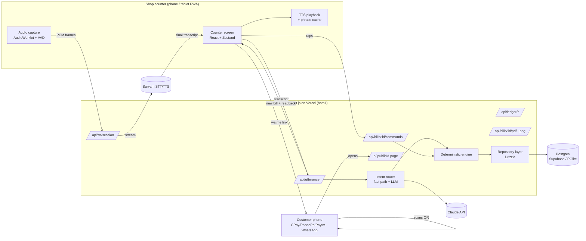
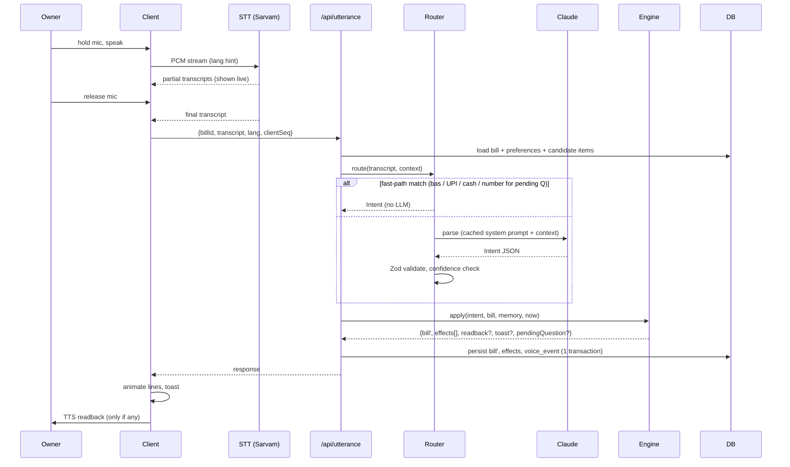
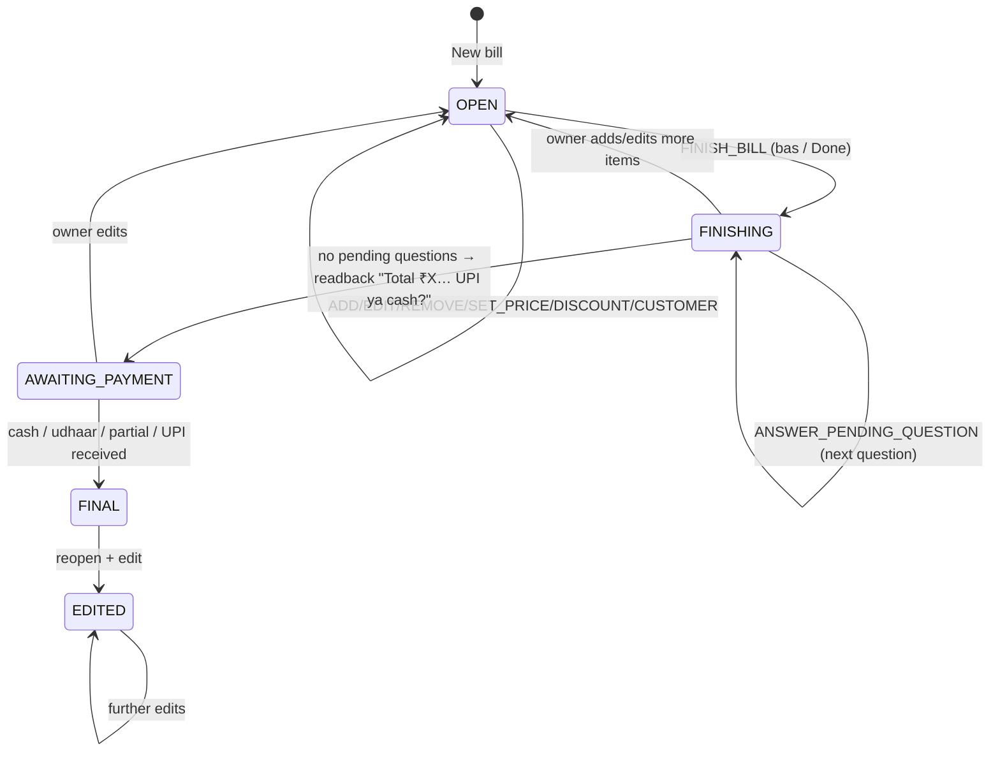

# Architecture — Boli-Quote

Companion to [PRD.md](PRD.md) (behaviour) and [TECH_STACK.md](TECH_STACK.md) (libraries). Contracts in this file (schemas, function signatures, API shapes) are binding; changing one requires a MEMORY.md *Decisions* entry.

---

## 1. Design tenets

1. **LLM parses, code decides.** One parse per utterance → strict JSON → deterministic engine. No money math in prompts.
2. **Server is the source of truth.** Every utterance/tap is a command to the server; the server returns the full new bill. The client renders it (optimistic UI only for taps).
3. **Pure engine.** `src/engine/*` = pure functions over plain objects. No DB, no network, no clock (time injected). Fully unit-tested.
4. **Adapters at every vendor edge.** STT, TTS, LLM, DB driver are behind interfaces so a failing vendor can be swapped mid-demo.
5. **Never block the flow.** Unknowns become *pending questions* resolved at finish, not interruptions.
6. **Paise integers** for all money; decimals only for quantity.

---

## 2. System context



---

## 3. The utterance pipeline (hot path)



### 3.1 Latency budget (target p95 ≤ 1.5 s from release to lines on screen)

| Step | Budget |
|---|---|
| STT finalisation after release | 300 ms |
| Network client → server | 60 ms |
| DB load (bill + prefs + items, 1 round trip, indexed) | 50 ms |
| LLM parse (cached prompt, low effort, ~250 output tokens) | 800 ms |
| Engine + DB write (single tx) | 60 ms |
| Response + render | 100 ms |
| **Total** | **≈ 1.37 s** |

Fast-path intents skip the LLM (≈ 500 ms end-to-end). Each `voice_events` row records `latency_ms` per stage for tuning.

### 3.2 Ordering & concurrency
- Client sends a monotonically increasing `clientSeq` per bill. Server processes a bill's utterances **serially** (row lock `SELECT … FOR UPDATE` on the bill) and rejects/reorders stale seqs.
- Offline / slow network: client queues utterances in IndexedDB, shows "connecting…", replays in order on reconnect.

---

## 4. Bill & conversation state machine



- DB `bills.status` stores `open | final | edited`. The sub-states `FINISHING` / `AWAITING_PAYMENT` live in `bills.session_state` (jsonb: `{phase, pendingQueue[], askedAt}`).
- **Pending question queue** is recomputed by `pendingQuestions(bill)` after every command; the *head* is shown as the chip. Order: unknown prices (line order) → ambiguous discount → missing customer for udhaar.
- During `OPEN`, pending items are **flagged but not asked** (P4). Asking starts at `FINISHING`.
- The ambiguous-discount question is the one exception asked immediately after the discount utterance (the owner just spoke about it and the answer determines the total) — still one short question, never mid-sentence.

---

## 5. Intent router

### 5.1 Fast path (deterministic, before LLM)
A small rule matcher in `src/router/fastpath.ts` handles high-frequency, unambiguous utterances in both languages:

| Pattern (normalised) | Intent |
|---|---|
| `bas`, `ho gaya`, `total batao`, `bill banao`, `hoye geche`, `total bolo` | FINISH_BILL |
| `upi`, `cash`, `nagad`, `udhaar likh do`, `baad mein dega` | RECORD_PAYMENT |
| a bare number / "10 rupaye" while a price question is pending | ANSWER_PENDING_QUESTION |
| `poore bill pe` / `sirf <items> pe` while discount question pending | ANSWER_PENDING_QUESTION |
| `discount hata do` | APPLY_DISCOUNT (remove) |
| `sab padh ke sunao` | READ_BILL |
| `aaj ka hisaab` | QUERY_LEDGER today_summary |

Anything else → LLM. Fast path also acts as the **timeout fallback**.

### 5.2 LLM call
- **System prompt** (static, cached): role ("You only parse; never compute or invent prices"), the PRD rules for qty/unit/price/scope, Hindi + Bengali number & unit word tables, ~30 few-shot examples covering every intent and the edit phrasings in PRD §5.5.
- **Per-request context** (after cache breakpoint): language hint, current bill lines `[{lineNo, name, qty, unit}]`, last-mentioned line, current pending question (if any), customer list names (top 50) for `SET_CUSTOMER`.
- The LLM does **not** receive the full catalogue or prices; item resolution is the engine's job.

### 5.3 Intent schema (Zod — `src/router/intent.schema.ts`)

```ts
export const Unit = z.enum(["kg","g","l","ml","pkt","pc","dozen","box","bottle","bag","m","unit"]);

export const IntentSchema = z.object({
  intent: z.enum(["ADD_ITEMS","EDIT_LINE","REMOVE_LINE","SET_PRICE","APPLY_DISCOUNT","SET_CUSTOMER",
    "FINISH_BILL","RECORD_PAYMENT","QUERY_LEDGER","QUERY_PRICE","SEND_REMINDER","READ_BILL",
    "ANSWER_PENDING_QUESTION","UNKNOWN"]),
  items: z.array(z.object({
    name: z.string(),                       // as spoken, normalised to Latin script
    qty: z.number().positive().default(1),  // 1 if none spoken
    unit: Unit.nullable(),                  // null if none spoken
    price: z.number().nonnegative().nullable(),   // rupees, null if none spoken
    price_basis: z.enum(["per_unit","line_total"]).nullable(),
  })).default([]),
  target_line: z.object({ ref: z.enum(["last","name"]), name: z.string().nullable() }).nullable(),
  changes: z.object({
    qty: z.number().positive().nullable(), unit: Unit.nullable(),
    price: z.number().nonnegative().nullable(), one_time: z.boolean().default(false),
    remove_discount: z.boolean().default(false),
  }).nullable(),
  discount: z.object({
    kind: z.enum(["percent","flat","target_total"]), value: z.number().nonnegative(),
    scope: z.enum(["whole","items","unspecified"]), item_names: z.array(z.string()).default([]),
    is_correction: z.boolean().default(false),
  }).nullable(),
  customer: z.object({ name: z.string() }).nullable(),
  payment: z.object({ mode: z.enum(["cash","upi","due","split"]), amount: z.number().nonnegative().nullable() }).nullable(),
  query: z.object({
    type: z.enum(["today_summary","dues_list","customer_balance","item_price_history","top_items"]),
    customer: z.string().nullable(), item: z.string().nullable(),
  }).nullable(),
  answer: z.object({ price: z.number().nullable(), scope: z.enum(["whole","items"]).nullable(),
    item_names: z.array(z.string()).default([]), customer: z.string().nullable() }).nullable(),
  language: z.enum(["hi","hinglish","bn","en"]),
  confidence: z.number().min(0).max(1),
});
export type Intent = z.infer<typeof IntentSchema>;
```

Additions vs. the original spec contract (`changes.remove_discount`, `discount.is_correction`, `answer`) exist so corrections and pending answers are explicit — record any further change in MEMORY.md.

### 5.4 Guard
`confidence < MIN_INTENT_CONFIDENCE (0.6)` or `UNKNOWN` or Zod failure → no bill change; respond `{ clarify: { transcript, suggestion? } }` → chip "Did you mean…? · Phir se boliye?".

---

## 6. Deterministic engine (`src/engine/`)

All functions are pure. `Money = number` (integer paise). `Qty = number` (≤ 3 decimals, rounded via `roundQty`).

| Module | Signature | Notes |
|---|---|---|
| `normalize.ts` | `normalizeText(s, lang): string` | lowercase, transliterate Devanagari/Bengali → Latin, strip filler ("ji", "na", "bhaiya"), unify spellings |
| `numbers.ts` | `parseQtyWords(tokens, lang): {qty, unitHint?}` | aadha/paav/sawa/dedh/dhai/saadhe/paune/sau + Bengali; backs up LLM numbers & fast path |
| `units.ts` | `canonicalUnit(s): Unit` · `convert(qty, from, to): number \| null` | families: mass (kg,g), volume (l,ml), count (pc,dozen); others convert only to themselves → `null` = incompatible |
| `resolveItem.ts` | `resolveItem(name, catalogue): {item, score} \| {newItem}` | exact alias → normalised exact → Fuse.js (threshold 0.35) with brand/size tokens boosted; below threshold → new item |
| `fillPrice.ts` | `fillPrice(line, item, spoken?): {rate, flags, memoryUpdate?}` | implements PRD FR-6.1/6.4 table |
| `learnPrice.ts` | `learnPrice(item, newRate, unit, {oneTime, source, billId}): Effect[]` | update item + history unless oneTime |
| `discount.ts` | `applyDiscount(bill, d, prefs): {bill', question?, effects}` | scope resolution, learned-pref lookup, target-total → flat |
| `discountLearning.ts` | `recordDiscountScopeAnswer(prefs, scope, wasCorrection): prefs'` · `learnedScope(prefs): "whole"\|"items"\|null` | ≥ `DISCOUNT_LEARN_MIN_ANSWERS` and ≥ `DISCOUNT_LEARN_AGREEMENT` |
| `totals.ts` | `computeTotals(bill): bill` | see §6.2 |
| `pending.ts` | `pendingQuestions(bill): Question[]` | unknown prices → ambiguous discount → udhaar customer |
| `payment.ts` | `applyPayment(bill, p, customer): {bill', effects}` | cash / upi / due / split |
| `readback.ts` | `readback(kind, data, lang): string` | short templated strings from i18n — never LLM-generated |
| `apply.ts` | `apply(intent, ctx): EngineResult` | dispatcher; the only entry point the API calls |

```ts
type EngineResult = {
  bill: Bill;                       // full new bill with computed totals
  effects: Effect[];                // persisted by repo layer in one tx
  readback?: { text: string; lang: Lang };
  toast?: string;
  question?: Question;              // head of pending queue, if asking
  clarify?: { transcript: string; suggestion?: string };
  queryResult?: LedgerCard;
};
type Effect =
  | { type: "upsertItem"; item: ItemDraft } | { type: "priceHistory"; row: PriceHistoryDraft }
  | { type: "savePrefs"; prefs: Preferences } | { type: "upsertCustomer"; c: CustomerDraft }
  | { type: "payment"; row: PaymentDraft } | { type: "customerBalanceDelta"; customerId: string; delta: Money };
```

### 6.1 Price-fill algorithm (per line)
1. Spoken price present → convert to per-unit of the **line's** unit (`line_total / qty` if basis = line_total). Rate = that. Unless `one_time`, emit `learnPrice(source=owner_spoken)` — memory stored in the item's `default_unit` (convert; if incompatible store with the line's unit and update `default_unit`).
2. Else item has memory → `convert(1 lineUnit → memoryUnit)`; compatible ⇒ rate = memRate × factor, flag `auto`; incompatible ⇒ flag `price_needed`.
3. Else → flag `price_needed` (+ `new_item` if created this bill).
4. `amount = round(rate × qty)` in paise (banker's rounding not used; standard half-up).

### 6.2 Totals order
```
line.amount            = round(rate × qty)
line.discountAmt       = percent ? round(amount × v/100) : min(flat, amount)
subtotal               = Σ(amount − discountAmt)          (lines with price_needed contribute 0 and block FINAL)
billDiscountAmt        = percent → round(subtotal × v/100) | flat → min(v, subtotal) | target_total → subtotal − target
preRound               = subtotal − billDiscountAmt
round_off              = target_total ? 0 : roundTo(preRound, ROUND_OFF_TO_PAISE) − preRound
total                  = preRound + round_off
balance_due            = total − paid_cash − paid_upi
```
Target total greater than subtotal → reject with readback "Total bill se zyada nahi ho sakta".

### 6.3 Discount scope learning
```
history: [{scope:"whole"|"items", ts, correction:boolean}]
learnedScope = (history.length ≥ 5 && maxShare ≥ 0.8) ? argmaxScope : null
```
- Ambiguous discount + `learnedScope == null` → question.
- Ambiguous discount + learned → apply, readback states scope, store `bill.session_state.lastAutoScope = {discountId}`.
- Correction intent (`is_correction`) targeting that discount → move, push `{scope: newScope, correction: true}` (an extra vote against the learned scope). Re-evaluate learnedScope.
- Settings reset → `history = []`.

---

## 7. Data model (Postgres, Drizzle schema in `src/db/schema.ts`)

Money columns are `bigint` paise; quantities `numeric(12,3)`; ids `uuid` (`gen_random_uuid()`); all timestamps `timestamptz`.

```sql
shop(id, name, address, phone, upi_vpa, gstin NULL, language_primary DEFAULT 'hi',
     language_secondary DEFAULT 'bn', next_bill_no int DEFAULT 1, created_at)

items(id, shop_id FK, name, name_norm, aliases text[], default_unit, price_per_unit bigint NULL,
      price_source text CHECK IN ('owner_spoken','owner_edited','auto') NULL,
      times_used int DEFAULT 0, last_updated, created_at)
  UNIQUE(shop_id, name_norm); GIN index on aliases; trigram index on name_norm (pg_trgm)

price_history(id, item_id FK, price_per_unit bigint, unit, source, bill_id NULL FK, created_at)
  INDEX(item_id, created_at DESC)

customers(id, shop_id FK, name, name_norm, phone NULL, balance_due bigint DEFAULT 0, created_at)

bills(id, shop_id FK, bill_no int, public_id text UNIQUE,  -- nanoid(12) for /b/<public_id>
      customer_id NULL FK, status text CHECK IN ('open','final','edited'),
      session_state jsonb DEFAULT '{}', client_seq int DEFAULT 0, version int DEFAULT 1,
      subtotal, item_discount_total, bill_discount_type NULL CHECK IN ('percent','flat','target_total'),
      bill_discount_value NULL, bill_discount_amount, round_off, total, paid_cash, paid_upi, balance_due,
      created_at, finalized_at NULL, edited_at NULL)
  UNIQUE(shop_id, bill_no); INDEX(shop_id, created_at)

bill_lines(id, bill_id FK ON DELETE CASCADE, line_no, item_id FK, name_snapshot, qty numeric, unit,
           rate bigint NULL, amount bigint, line_discount_type NULL, line_discount_value NULL,
           line_discount_amount bigint DEFAULT 0, flags text[] -- auto | new_item | price_needed | one_time
)

payments(id, shop_id FK, customer_id NULL, bill_id NULL, amount bigint, mode CHECK IN ('cash','upi'), created_at)

preferences(shop_id PK FK, discount_scope_history jsonb DEFAULT '[]',
            discount_scope_learned text NULL, other_prefs jsonb DEFAULT '{}')

voice_events(id, shop_id, bill_id NULL, transcript, lang, route ('fast'|'llm'|'fallback'),
             intent_json jsonb, outcome ('applied'|'clarify'|'error'), latency_ms jsonb, created_at)

bill_versions(id, bill_id FK, version, snapshot jsonb, created_at)   -- written on each re-finalise of an edited bill
```

Notes
- `udhaar` = `bills.balance_due > 0` **and** `customers.balance_due += delta`. Payments against dues ("Sharma ji ne 500 diya") insert a `payments` row with `bill_id NULL` and decrement balance.
- "Aaj ka hisaab": `SUM` over `bills` finalised today (Asia/Kolkata) + `payments` today grouped by mode.
- Days pending = now − oldest unpaid bill for the customer.

---

## 8. API surface (Next.js route handlers, all JSON, Zod-validated)

| Method & path | Purpose |
|---|---|
| `POST /api/bills` | Create open bill → `{bill}` |
| `GET /api/bills/:id` | Fetch bill |
| `POST /api/utterance` | `{billId, transcript, lang, clientSeq}` → `EngineResult` (voice path) |
| `POST /api/bills/:id/commands` | Tap path: `{type:"editLine"\|"removeLine"\|"setRate"\|"addDiscount"\|"removeDiscount"\|"setCustomer"\|"pay"\|"finish"\|"reopen", ...}` → `EngineResult` (same engine, no LLM) |
| `GET /api/bills/:id/pdf` · `GET /api/bills/:id/png` | Exports |
| `GET /b/:publicId` | Public bill page (SSR, no auth, no internal ids) |
| `GET /api/ledger/today` · `/dues` · `/customers/:id` · `/items/:id/history` · `/top-items` | Hisaab cards |
| `POST /api/customers/:id/payments` | Record payment against dues |
| `GET /api/customers/:id/reminder-link` | Builds `wa.me` URL + message |
| `CRUD /api/items`, `/api/customers`, `GET/PUT /api/settings`, `POST /api/settings/discount-pref/reset` | Management screens |
| `POST /api/stt/session` | Short-lived STT credential / WS proxy |
| `POST /api/tts` | `{text, lang}` → audio (cached) |
| `POST /api/demo/reset` | Re-seed (only when `DEMO_MODE=true`) |

Voice and tap paths share `engine.apply` — taps are translated into the same `Intent` shape with `confidence: 1`.

---

## 9. Client architecture

```
app/(counter)/page.tsx           Counter screen
  <TopBar/>                       shop name · today total · language toggle
  <LiveBill/>                     lines (motion), badges, swipe-to-delete, tap → <LineEditSheet/>
  <PendingChip/>                  head question; tap opens number pad / scope picker
  <ClarifyChip/>                  low-confidence transcript
  <TranscriptStrip/>              partial + final transcript
  <MicButton/>                    hold-to-talk | hands-free toggle
  <ActionBar/>                    Done · UPI QR · WhatsApp · Print · New bill
  <UpiQrSheet/>                   full-screen QR + "Received" button
store/bill.ts (Zustand)           bill, pending, mic state, queue status
voice/                            capture.ts, vad.ts, adapters/{sarvam,webspeech,replay}.ts, tts.ts
lib/offlineQueue.ts               IndexedDB utterance queue + replay
```

- **Rendering a bill:** `toBillViewModel(bill, shop, lang)` (shared, in `src/bill/viewModel.ts`) feeds `<LiveBill/>`, `/b/:publicId`, the PDF document, the PNG `ImageResponse` and the print stylesheet — one layout, five renderers.
- **Tap edits:** optimistic update in store → `POST commands` → replace with server bill. On error, revert + toast.

---

## 10. Exports & sharing

| Output | How |
|---|---|
| UPI URI | `buildUpiUri({vpa, name, amountPaise, billNo})` in `src/bill/upi.ts` (unit-tested encoding, amount as `123.00`) |
| QR | `qrcode.toString(uri, {type:"svg"})` on screen; `toDataURL` for PDF/PNG |
| PDF | `@react-pdf/renderer` `<BillPdf vm/>` streamed from route |
| PNG | `next/og` `ImageResponse` of `<BillImage vm/>` (600 px wide) |
| Print | `/print/:id` route with 58 mm CSS, auto `window.print()` |
| WhatsApp share | `https://wa.me/?text=` (or `wa.me/91<phone>`) + message + `${APP_URL}/b/${publicId}`; Web Share API with PNG file where supported |

---

## 11. Internationalisation
- `src/i18n/{hi,bn,en}.ts` — typed dictionaries for UI labels, readback templates, questions, toasts. Readbacks are **templates with slots**, e.g. `hi.readback.total = "Total ₹{total}. {count} item{discount}. UPI ya cash?"`.
- Number formatting: `Intl.NumberFormat("en-IN")` (₹1,840) for both languages; spoken numbers rendered by TTS.
- Language toggle sets: UI labels, STT language hint, TTS voice, readback language.
- Lexicons: `src/engine/lexicon/{hi,bn}.ts` — number words, unit words, edit verbs, finish words, common item synonyms (doodh/dudh → milk, chawal/chal → rice, dal/daal …).

---

## 12. Folder structure

```
/
├─ AGENTS.md  CLAUDE.md  README.md  MEMORY.md  BUILT_WITH_FLOW.md
├─ docs/  PRD.md  ARCHITECTURE.md  TECH_STACK.md  BUILD_PLAN.md  DEMO.md
├─ src/
│  ├─ app/                      Next.js routes (counter, hisaab, items, customers, bills, settings, b/[publicId], print/[id], api/*)
│  ├─ components/               UI components (+ ui/ from shadcn)
│  ├─ store/                    Zustand stores
│  ├─ voice/                    capture, vad, stt/tts adapters
│  ├─ router/                   fastpath.ts, llm.ts, prompt.ts, intent.schema.ts, route.ts
│  ├─ engine/                   pure logic (see §6) + lexicon/
│  ├─ bill/                     viewModel.ts, upi.ts, pdf.tsx, image.tsx
│  ├─ db/                       schema.ts, client.ts (pg | pglite), repo/*.ts, seed.ts
│  ├─ i18n/                     hi.ts, bn.ts, en.ts, index.ts
│  ├─ config/                   constants.ts, env.ts
│  └─ lib/                      money.ts, qty.ts, time.ts, offlineQueue.ts
├─ public/demo-clips/           pre-recorded backup audio (hi + bn)
├─ tests/
│  ├─ unit/                     engine tests
│  ├─ fixtures/utterances/      transcript → expected intent/lines (hi, bn)
│  ├─ fixtures/intents/         recorded LLM outputs for LLM_MODE=fixture
│  ├─ acceptance/               AT-01 … AT-16 (Playwright + transcript injection)
│  └─ eval/                     parser accuracy script (live LLM, run manually)
└─ drizzle/                     migrations
```

---

## 13. Resilience & demo mode

| Failure | Behaviour |
|---|---|
| STT vendor down | Banner + switch adapter to `webspeech` (Settings → Demo or auto after 2 failures) |
| Noisy venue | `replay` adapter plays bundled clips through the same pipeline; or type transcript in hidden dev field (`?debug=1`) |
| LLM timeout / error | Fast-path result if matched, else clarify chip; bill never changes on failure |
| Network drop | Utterances queued in IndexedDB, "connecting…" pill, ordered replay |
| DB error | Transaction rolls back; client keeps last good bill; toast "Dobara try karein" |
| Demo reset | `POST /api/demo/reset` truncates + reseeds (~40 items, 5 customers with dues, optional "pre-trained" discount history profile for the learned-phase demo) |

**Demo profiles** (profile switcher): `fresh` (no discount history) and `trained` (5× "whole" history) so either branch of PRD §7.2 can be shown instantly.

---

## 14. Observability
- Every utterance → `voice_events` (transcript, route, intent JSON, outcome, per-stage latency).
- `/settings/debug` (DEMO_MODE only): last 50 voice events, p50/p95 latency, fast-path hit rate.
- Server logs structured JSON; never log full phone numbers.

## 15. Security & privacy
- No auth in hackathon build; deploy demo instance only. Public bill page exposes only the view-model via unguessable `public_id`.
- API keys server-side only; STT via short-lived tokens or proxy.
- Phone numbers stored only when typed/picked by owner; never sent to LLM.
- Customer names sent to the LLM only as the short list needed for `SET_CUSTOMER` matching.
